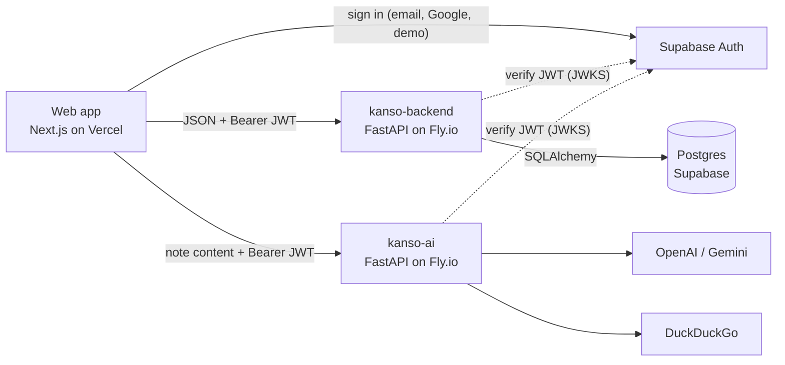

<picture>
  <source media="(prefers-color-scheme: dark)" srcset="brand/logo/kanso-lockup-horizontal-dark.svg">
  
</picture>

**Keep it kanso.** Tasks, notes and habits in one calm place. kanso plans your day, keeps your notes, tracks your streaks, and tells you what to focus on next.

**Live app: [kanso-web-app.vercel.app](https://kanso-web-app.vercel.app)**. Click **Try the demo** to open a private sandbox with sample data. No signup needed.

This repository is the web app. kanso is three services, each in its own repository:

| Repository | What it is | Stack | Hosting |
|---|---|---|---|
| **kanso-frontend** (this repo) | Web app | Next.js 16, React 19, TypeScript, Tailwind CSS v4, Tiptap | Vercel |
| [kanso-backend](https://github.com/LuisFVillalon/kanso-backend) | JSON API and data layer | FastAPI, SQLAlchemy 2, Alembic, Postgres (Supabase) | Fly.io |
| [kanso-ai](https://github.com/LuisFVillalon/kanso-ai) | Learning-resource recommendations | FastAPI, OpenAI or Gemini, DuckDuckGo search | Fly.io |

## Features

- **Tasks**: due dates and times, priorities, tags, time estimates, and a filterable, sortable list. Linked tasks (tasks that lead up to a parent task) nest under their parent in a collapsible block with "x of y done" progress, and a linked task that matches a filter still shows under its parent. The create and edit task forms have a "Linked tasks" section to link existing tasks (a task has one parent, and links are one level deep), add new ones by title (created on save with the parent's tags and no due date), and reorder or unlink them; it shows the total estimate and warns when a linked task is due after its parent. Completing a parent with open linked tasks asks whether to complete them all or just the parent, finishing the last open linked task offers to complete the parent, and deleting or archiving a parent asks whether to keep its linked tasks as standalone tasks (the default) or take them along; Undo on the delete toast re-links them.
- **Notes**: a Tiptap rich-text editor with tables, highlights, resizable images and text alignment, organized by tag folders in grid or list view. Notes export to PDF, and editing time is tracked per note.
- **Learning resources (AI)**: from any note, get one video, one article and one exercise for going deeper. An LLM reads the note and plans the searches, then real search results are filtered, dead-link-checked and ranked by deterministic code, so the model never invents a link.
- **Habits**: daily check-ins, current and best streaks, and a 30-day history you can edit retroactively.
- **Mood check-ins**: once your "Call it a day" time passes on a non-rest day, a dashboard card asks how the day felt. Tap one of five faces (Rough to Great, or keys 1–5), optionally add energy, stress, tags and a short note, and save; Undo is on the toast. "Not today" leaves a small chip to log it later and "In 1 hour" snoozes it. Settings → Profile → Mood check-ins turns the nudge on or off and sets when it appears. Check-ins are private and never sent to the Daily Brief.
- **Daily debrief**: overdue work, what's due today, whether today's plan fits your available hours, and a short "focus next" list. It's rule-based on the backend; no LLM is involved.
- **Big-picture calendar**: a year and month view of tasks, habits and notes, a week view that lays out planned and completed tasks, note-editing time (nearby sessions of a note on the same day merge into one block showing the time actually worked) and habit check-ins on an hourly timeline (click an empty slot to create a task at that time), plus a term tracker with a countdown. Its Report view summarizes any week, month or year, counting archived tasks, notes and habits too: tasks completed vs. planned, estimated hours, time in notes, habit check-ins and streaks, the busiest days and an activity chart, plus mood from your daily check-ins (an average, how many days were logged and a mood-over-time chart; "Mood & your activity" shows how mood tended to move with tasks completed, note time and habit check-ins, in plain language with a sample-size caveat, and "Tags & mood" compares average mood on days with each mood tag; a week's summary covers the trailing 4 weeks). Click a day's dot to edit its check-in or a hollow one to log a missed day; "Show mood in reports" in Settings hides it.
- **Customizable dashboard**: drag-and-drop, resizable stats widgets; accent colors; notebook page styles; focus mode; and a doodle canvas.
- **Archive**: archive tasks, notes, tags and habits to hide them from the dashboard, calendar, daily debrief and stats without deleting them. Archived tags disappear from pickers, filters and note folders but stay attached to their tasks and notes; archived habits keep their history. The Archive page lists everything archived, with Restore and Delete, and its Tasks and Notes tabs can be filtered by tag (including archived tags).
- **Recently deleted**: deleting a task, note, tag or habit moves it to Recently deleted for 30 days, with an Undo on the confirmation toast. The Recently deleted page lists them newest first with the days left before each is deleted for good, filters by kind, and offers Restore (back where it was, or to the Archive if it was archived) and Delete forever.
- **Notifications**: in-app alerts behind a bell in the dashboard header: a morning summary of tasks due today, a reminder before a task is due (2 hours by default, or a lead picked per task under "Remind me"), a final warning 30 minutes before, one overdue nudge, and an evening habit reminder before "Call it a day". The panel lists them newest first; opening one marks it read and opens its task or habit, and each can be dismissed. New ones arrive as a toast while the tab is open. Settings → Notifications switches each type on or off and sets quiet hours and the default reminder time. The backend computes alerts on demand, so the app polls about once a minute while visible, sending the browser's time zone.
- **Canvas connection**: Settings → Integrations connects your school's Canvas with its address and a personal access token. kanso checks the token with Canvas before saving it, keeps it only on the backend, and never shows it again: Settings shows "ends in …xxxx", the Canvas account, expiry and last sync, with Test, Replace and Remove, plus "Courses to show". A token that Canvas rejects or that expires asks you to reconnect, and Remove deletes it permanently (it doesn't go to Recently deleted). Not available in the demo.
- **Accounts**: email/password (with a NIST-style password policy) or Google sign-in, plus account settings and account deletion.

## Architecture



- Supabase is used **only for authentication**. All data goes through the FastAPI backend, which verifies the Supabase JWT on every request and scopes every query to the token's user. The database's auto-generated REST API is locked down, so the public Supabase key grants no data access.
- The AI service is separate from the backend so the slow, rate-limited LLM and search path can't tie up the main API's workers. It verifies the same JWT and rate-limits each user.

## Engineering notes

A few decisions worth calling out:

- **A private sandbox per demo visitor.** "Try the demo" signs in with a Supabase *anonymous* user, then the backend seeds that user with sample data dated relative to the visitor's local day. Visitors never share an account, and the backend deletes sandboxes after a day. `AuthContext` keeps data loading paused until the seed finishes, so the dashboard never flashes an empty sandbox.
- **Timezone-correct "today."** The server runs in UTC, but habits and the daily debrief care about the user's calendar day. Those endpoints take the caller's `local_date` and `local_time` instead of trusting the server clock (`utils/dateUtils.ts`).
- **Shared data without refetching.** `AppDataProvider` mounts the task, tag, habit and note stores once in the root layout, so data survives client-side navigation. They're four separate contexts, so typing in a note doesn't re-render the calendar.
- **Local-first, backend-authoritative preferences.** Theme, layout and view settings render instantly from `localStorage`, then yield to the saved profile once it loads. Inline scripts in `layout.tsx` apply the theme before first paint to prevent flashes.
- **Errors surface as toasts.** Failed saves roll back optimistic updates and show the server's reason when it has a user-facing one (for example, a duplicate tag name).

## Project structure

```
src/app/
  page.tsx               # Landing page when signed out, dashboard (TaskManager) when signed in
  TaskManager.tsx        # The dashboard
  notes/ calendar/ archive/ trash/  # /notes, /calendar, /archive and /trash (Recently deleted) pages
  login/ signup/ auth/callback/
  error.tsx not-found.tsx opengraph-image.tsx
  fonts.ts               # Fraunces (display) and M PLUS Rounded 1c (body), via next/font
  favicon.ico icon.svg apple-icon.png manifest.webmanifest  # App icons and web manifest
  components/            # Grouped by domain: task, notes, habit, calendar, stats, settings,
                         # mood, landing, doodle, tag, auth, notifications; plus common/ and layout/ (cross-domain)
  context/               # Auth, Toast, Notifications, and the Tasks/Tags/Habits/Notes data providers
  hooks/                 # Data hooks (useTasksAndTags, useNotes, useHabits, useProfile, ...)
  lib/backend-api.ts     # Every backend and AI-service request, with auth headers and typed errors
  lib/supabase.ts        # Supabase client (auth only)
  utils/                 # Date helpers, note-content extraction for the AI service, ...
brand/                   # The brand kit: DESIGN.md (source of truth for look and voice),
                         # tokens, logo, icons and snippets
public/                  # Web-manifest icons
```

## Running locally

Requires Node.js 20.9 or newer, plus running instances of [kanso-backend](https://github.com/LuisFVillalon/kanso-backend) and (for learning resources) [kanso-ai](https://github.com/LuisFVillalon/kanso-ai).

```bash
npm install
cp .env.example .env.local   # then fill in the values
npm run dev                  # http://localhost:3000
```

| Variable | Description |
|---|---|
| `NEXT_PUBLIC_KANSO_API_URL` | Base URL of kanso-backend (e.g. `http://localhost:8000`) |
| `NEXT_PUBLIC_KANSO_AI_URL` | Base URL of kanso-ai (e.g. `http://localhost:8080`) |
| `NEXT_PUBLIC_SUPABASE_URL` | Supabase project URL |
| `NEXT_PUBLIC_SUPABASE_ANON_KEY` | Supabase publishable (anon) key |
| `NEXT_PUBLIC_SITE_URL` | Optional. Canonical production URL, used for OAuth redirects and link previews |

For "Try the demo" to work, the Supabase project needs **Anonymous sign-ins** enabled (Authentication → Sign In / Providers).

| Script | Description |
|---|---|
| `npm run dev` | Development server |
| `npm run build` / `npm start` | Production build / serve it |
| `npm run lint` | ESLint (Next.js core-web-vitals + TypeScript rules) |

## Author

Luis Fernando Villalon, San Diego State University. [github.com/LuisFVillalon](https://github.com/LuisFVillalon)
