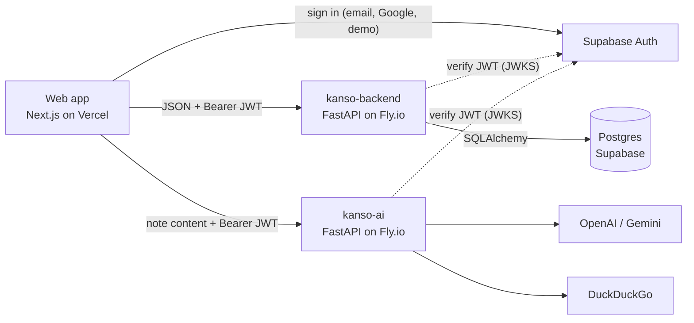

<picture>
  <source media="(prefers-color-scheme: dark)" srcset="brand/logo/kanso-lockup-horizontal-dark.svg">
  
</picture>

**Keep it kanso.** Tasks, notes and habits in one calm place. kanso plans your day, keeps your notes, tracks your streaks, and tells you what to focus on next.

**Live app: [kanso-web-app.vercel.app](https://kanso-web-app.vercel.app)**. Click **Try the demo** to open a private sandbox with sample data. No signup needed.

This repository is the web app. kanso is three services, each in its own repository:

| Repository | What it is | Stack | Hosting |
|---|---|---|---|
| **kanso-frontend** (this repo) | Web app | Next.js 16, React 19, TypeScript, Tailwind CSS v4, Tiptap | Vercel |
| [kanso-backend](https://github.com/LuisFVillalon/kanso-backend) | JSON API and data layer | FastAPI, SQLAlchemy 2, Alembic, Postgres (Supabase) | Fly.io |
| [kanso-ai](https://github.com/LuisFVillalon/kanso-ai) | Learning-resource recommendations | FastAPI, OpenAI or Gemini, DuckDuckGo search | Fly.io |

## Features

- **Tasks**: due dates and times, priorities, tags, time estimates, and a filterable, sortable list. Linked tasks (tasks that lead up to a parent task, at any depth) are tasks in the list like any other: each is its own card, filtered and sorted on its own, with a trail under its title naming its original task and the task before it ("…" stands for any in between); clicking a name scrolls to that task's card and highlights it, or offers to clear the filters when they hide it. A parent card shows "x of y done" progress and a chip for each linked task that goes to its card, and an "Only top-level tasks" toggle in the toolbar (saved with Show and Sort) hides the linked tasks. "+ Linked task" on any card opens a form under it with every task field (title, due date and time with quick picks relative to the parent, priority, reminder, description, estimate, and tags that start as the parent's), creating the task as a linked task right away, with "Create and add another" for the next one. The create and edit task forms have a "Linked tasks" section to link existing tasks (a task has one parent, and can't be linked under a task below it), add new ones that open with the same full fields (created on save), open an existing linked task in the same editor with a link back, and reorder or unlink them; it shows the total estimate and warns when a linked task is due after its parent. Completing a parent with open linked tasks asks whether to complete them all or just the parent, finishing the last open task under a task's open parent (including anything nested deeper) offers to complete that parent, and deleting or archiving a parent asks whether to keep its linked tasks (the default: the ones directly under it become standalone, keeping their own linked tasks) or take them along, listing what each choice does; Undo on the delete toast re-links them.
- **Notes**: a Tiptap rich-text editor with tables, highlights, resizable images, text alignment, checklists, links (Ctrl+K), quotes, code blocks and dividers, organized by tag folders in grid or list view. Notes save on their own: the toolbar shows Saved, Saving or Not saved (click it to retry), and Ctrl+S saves right away. The toolbar has two rows. The first is about the note: the sidebar toggle, where the note lives (its tag folder / title), the save status, the word count (opens Note details: words, reading time and time spent in the note), Outline (the note's headings), Export (PDF), and on the Notes page Focus mode (the logo's k, which presses down when clicked; Ctrl+Shift+F, Esc to leave; in focus mode the toolbar stays at the top with the save status, a Leave focus button showing the X and the k, and the formatting tools) and Resources, then a More menu that holds Note details and whatever the row has no room for. The second row is only formatting: undo, redo, text style, bold, italic, underline, strikethrough, highlight, lists, checklist, table, image, link, quote, code block and alignment; when the editor is too narrow for all of them, the groups that don't fit move into a ⋯ menu at the row's end. On a phone, or when the editor is narrower still, the formatting tools sit in a bar under the note, which folds the same way. On the home page a note opens in the Notes panel, whether picked from the cards or from a folder (its header then leads back to the folder); Expand opens it centered over the page and Back to panel returns it, and the next note opens the way you left it on this device. Type / for a menu of blocks, or select text for a menu with formatting and link. Tab indents; Shift+Tab, or Esc then Tab, moves focus out of the editor. Editing time is tracked per note.
- **Learning resources (AI)**: from any note, get one video, one article and one exercise for going deeper. An LLM reads the note and plans the searches, then real search results are filtered, dead-link-checked and ranked by deterministic code, so the model never invents a link.
- **Habits**: daily check-ins, current and best streaks, and a 30-day history you can edit retroactively.
- **Mood check-ins**: log or edit the day's mood at any time, rest days included, from a chip in the upper right of Today's Activity Log while the Daily Brief is open and from a day's mood chip in the calendar day panel (Log mood, or the mood with Edit). Once you've passed "Call it a day" without logging the day's mood, a reminder above the Daily Brief offers Log mood until it's logged. Tap one of five faces (Rough to Great, or keys 1–5), optionally add energy, stress, tags and a short note, and save; Undo is on the toast. Weekly and monthly check-ins are opt-in: on Sunday (end of the Mon–Sun week) and on the month's last day a "Log this week" or "Log <month>" chip appears on the dashboard, with an overall mood plus workload and a best part of the week, or progress on what matters and the month in one word; any past week or month can be logged or edited later from Reports. Settings → Notifications → Mood check-ins turns each one on or off: the Mood check-in reminder switch covers the daily check-in (Log mood, the reminder above the Daily Brief and the reminder notification, plus the missed-days notice), and weekly and monthly have their own switches. Check-ins are private and never sent to the Daily Brief.
- **Daily debrief**: overdue work, what's due today, whether today's plan fits your available hours, and a short "focus next" list. It's rule-based on the backend; no LLM is involved.
- **Calendar**: a month view of tasks, habits and notes, with the year at a glance above it (all twelve months as small grids shaded by how busy each day is: click a month to show it, or a day to pick it) and the picked day's summary beside it (arrow keys, Home/End and Page Up/Down move the picked day; paging to another month clears it), and a week view that lays out planned and completed tasks, note-editing time (nearby sessions of a note on the same day merge into one block showing the time actually worked) and habit check-ins on an hourly timeline, along with events (click an empty slot to add a task at that time, or drag out a range to add an event there; the quick-add beside it switches between Task and Event and has More options for the full form; drag the handle under the timeline to make it taller, and the height is remembered on this device), with your rest days hatched, the hours outside your work window washed out and dashed lines where the window opens and closes, as set in Settings → Work day and rest. That page sets one work window for every day; turning on Different hours on some days lists each work day so any of them can have its own start and Call it a day time, one that runs past midnight included (Same as default puts it back), and each day's own window is the one the day timer, Call it a day, the mood check-in reminder and the week view use. Events (New event in the week view, or a dragged range) have a title, a description, any of your tags, a start and end time (all day, or running past midnight) and an optional reminder, and can repeat weekly, every 2 weeks or every few weeks on the days you pick, from a start date until a date, the end of the term or forever. They sit beside tasks in their first tag's color; past events fade and archived past ones are hatched. Clicking one opens its card with Edit, Archive (or Restore) and Delete, and for a repeating event each asks whether it applies to this event, this and the following ones, or all of them. Archiving keeps past occurrences on the calendar and takes upcoming ones off it; deleted events go to Recently deleted for 30 days. Both views page back and forward through past and future years (Today jumps back). It reopens in the view you last used on this device. The month view, the year at a glance and the dashboard's month tile mark the term tracker's period with a band along those days (the current term in the accent color, archived terms muted), and the month view names each term above the month and the year at a glance in its legend.
- **Reports**: its own page (from the navigation rail, or G R) that summarizes any week, month or year in three tabs, Productivity, Mood and Time, whose views each fit one screen, counting archived tasks, notes and habits too. A small switch beside the tabs picks the open tab's view: Productivity has Overview, Tasks, Notes and Habits (a square per day, or per month in a year), Mood has Over time and Patterns, and Time has one view; on a phone all three tabs fit and the switch drops to its own line. Overview has the stat tiles, the activity chart, a few highlights (busiest day, the note with the most time, the current streak, your mood or how it moved with your activity, the tag that took the most time) and a one-line share bar of where your time went; a tile, highlight or the bar opens its view, and the Mood tile, the mood highlights and the share bar jump to the Mood or Time tab. Each tab reopens on the view it was last left on. The open view is in the URL (`?view=tasks`, `?view=mood&mood=patterns`, the same links as before the tabs were grouped), so Back, reloads and links keep it, and changing the period keeps it too. The report covers tasks completed vs. planned, estimated hours, time in notes, habit check-ins and streaks, the busiest days and an activity chart (with a labeled y axis showing how many were done, or how much time in notes), plus mood from your check-ins (an average, how many days were logged and a mood-over-time chart that stacks mood, energy and stress on one shared timeline, each with its own words on its scale (hovering or tapping a day lights it up in all three and lists its values; a Month adds each line's 7-day trend and a Year fades months with fewer than 8 days); "Mood & your activity" shows how mood tended to move with tasks completed, note time and habit check-ins, in plain language with a sample-size caveat, and "Tags & mood" compares the average mood on days with each mood tag with your usual (your average across every check-in in the period): a bar toward lower or higher mood from a labeled center, the tag's mood as a face and the difference, like +0.7; tap or click a row (one at a time) to show the full sentence under it, which also shows on hover and is read to screen readers; "Tags & feelings" shows mood, energy and stress on days with each of your own tags (a day you finished a task or edited a note carrying it) as grouped bars against your usual, comparing work days with work days and days off with days off, labelled with the days each bar averages, with an arrow only when a gap is too big to be chance and "Too few days to tell" until a tag has 5 days on each side; tap a tag to open a timeline of the period with its days highlighted, for mood, energy or stress. A week covers only its own days, and since that's too few for mood patterns its Patterns show only Tags & feelings, hatched, with a note pointing to its Month report, where the others appear along with the Year report; a month with nothing clear in Tags & feelings points to its Year report). Mood colors run from brick (Rough) through amber and stone to steel and ink blue (Great), checked to stay apart under red/green and blue/yellow color blindness in light and dark, and a face or word always goes with them: the Mood over time scale and the Check-ins counts show the face beside each mood. Weekly check-ins show as dashed spans across their week and in a list, and the Year view adds a ◇ for each monthly check-in and "Months in a word". Click a day to edit its check-in, or a hollow dot to log a missed day (on a touch screen the first tap shows the day and a second tap opens it); in the Year view, clicking a month opens it; click a weekly span, a ◇, or a week or month in the list to edit that check-in. While weekly or monthly check-ins are on, the Mood tab's list (Over time) includes each of the Month view's weeks so far and the Year view's "Months in a word" each month so far, so a past week or month without one can be logged, even in a period with nothing else recorded. "Where your time went" shows how much each tag took: a share bar over one row per tag with its total and its share, split into tasks, notes and habits, and a short hint that tapping a tag shows what's behind it. It doesn't compare with the period before. Time adds up completed tasks' estimates, the time spent editing notes and each habit check-in's estimate; Count adds one per completed task, note worked on and habit check-in, and Tasks, Notes and Habits can each be switched off. Something with several tags is split evenly between them, untagged items get their own row, and tags past the top eight fold into "Other tags". Click a tag to see the tasks, notes and habits behind it. Every chart explanation is written for someone without a math or statistics background: Mood over time sums itself up in a sentence or two and labels its marks in the legend, so in the Year view each month's dot shows how the month felt and the shaded bar is where most of its days fell (its middle half).
- **Customizable dashboard**: drag-and-drop, resizable stats widgets (including a term tracker with a countdown to the end of the term, set in Settings → Term Tracker, where Archive term keeps a finished term marked on the month calendars and starts the tracker fresh for the next one; archiving is optional, and a term that's replaced without archiving drops off the calendars; archived terms are listed there with a delete. Set up next term queues the following term ahead of time (shown as "Starts <date>" with edit and remove): once the current term has ended it becomes the tracker's term, and the countdown and calendars switch to it on their own, checked again at midnight and on coming back to the app. A queued term isn't marked on the calendars until it takes over. The Archive this term automatically when it ends switch (off by default) archives the term at that point; with it off, a term the next one replaced is offered there to archive or let go), with Widgets and Week tabs to swap the widgets for the week view (remembered on this device), which can be dragged taller and opens at that height again (also remembered on this device), the area easing to the other view's height on a switch; accent colors; notebook page styles; focus mode (the kanso mode, marked with the logo's k); and a doodle canvas.
- **Archive**: archive tasks, notes, tags and habits to hide them from the dashboard, calendar, daily debrief and stats without deleting them. Archived tags disappear from pickers, filters and note folders but stay attached to their tasks and notes; archived habits keep their history. The Archive page lists everything archived, with Restore and Delete, and its Tasks and Notes tabs can be filtered by tag (including archived tags).
- **Recently deleted**: deleting a task, note, tag or habit moves it to Recently deleted for 30 days, with an Undo on the confirmation toast. The Recently deleted page lists them newest first with the days left before each is deleted for good, filters by kind, and offers Restore (back where it was, or to the Archive if it was archived) and Delete forever. Delete all forever, after a confirmation naming the count, permanently deletes everything the current filter shows; if some fail, it says how many and keeps them in the list.
- **Notifications**: in-app alerts behind a bell in the dashboard header: a reminder before a task is due (2 hours by default, or a lead picked per task under "Remind me"), a reminder before an event starts (for events that set one), a mood check-in reminder before that day's "Call it a day" (1 hour by default, or any lead under a day from a preset or a custom amount) if the day's mood isn't logged, and a notice when days go by without a mood check-in (only while the mood check-in reminder is on). The panel lists them newest first; opening one marks it read and opens its task, habit or mood check-in form (a missed-days notice offers a chip per day), and each can be dismissed. New ones arrive as a toast while the tab is open. Settings → Notifications groups them into Reminders (with the default reminder time), Mood check-ins (with the mood reminder's lead) and Quiet hours, each type with its own switch. The backend computes alerts on demand, so the app polls about once a minute while visible, sending the browser's time zone.
- **Canvas connection**: Settings → Canvas connects your Canvas account one of two ways. The recommended way is your private calendar feed link (Canvas → Calendar → Calendar Feed): it's read-only and needs no approval from your school, but carries only your upcoming assignments and due dates, with no grades, submissions, announcements or course files. If your school allows student tokens, you can connect with your school's Canvas address and a personal access token instead, which also brings in courses, grades and announcements. Anyone with the feed link can read your calendar, so kanso handles it like the token: it checks either with Canvas before saving it, keeps it only on the backend, and never shows it again. Settings shows which way you're connected ("Connected · calendar feed", or "ends in …xxxx" with the token's expiry), the Canvas account and last sync, with Test, Replace and Remove, plus "Courses to show" (a token's courses, or the classes in a calendar feed's due dates). Connected with the feed, it also notes that an access token would add grades, modules, announcements and submitted work. A token or feed link that Canvas rejects, or a token that expires, asks you to reconnect, and Remove deletes it permanently (it doesn't go to Recently deleted). Not available in the demo.
- **Canvas panel**: once Canvas is connected, with either the calendar feed or a token (always in the demo), the home page adds a Canvas panel next to Tasks and Notes. The panels sit under a strip of tabs, like a browser's: one tab per panel, and the panels shown side by side share one split tab (such as Tasks + Notes). Click a panel's tab to show it alone; the split tab stays in the strip, so its ⧉ brings the split back in one click, each half of it shows only that panel, and a half's × takes that panel out of the split. A tab's open-beside button adds that panel to the split. From the keyboard, a tab's menu (right-click, the context menu key or Shift+F10) offers the same: adding that panel to the split, or taking a half out of it. One panel on fills the width, two share the split, and three sit in columns, with the dividers between them dragged to resize the widths and the handle below to make the panels longer. The last panel on stays on. The panels you turn on are saved to your profile, and the last split is remembered on that device. Without Canvas connected, a dashed + Canvas tab opens Settings → Canvas; if you don't use Canvas, its × closes it (Undo is on the toast, and Settings → Canvas brings it back). Drag a tab to put the panels in your own order (dragging a half of the split tab moves that panel within the split), or focus a tab and press Shift and an arrow key; the arrow keys alone move between the tabs. The order is remembered on that device and is shared by the wide screen and the phone. A phone shows one panel at a time: swipe between them, or tap the labelled Tasks / Notes / Canvas tabs above, and it remembers its pick on that device without changing the wide screen's panels. Hold a tab and drag it, or press Shift and an arrow key, to move it. Opening a task from the Canvas panel ("In tasks") or making a note (New note, or N) brings Tasks or Notes on screen if it's off. The Canvas panel's Upcoming tab shows missing or late work, what's due over the next 7 days or, with All upcoming (remembered on this device), everything on your Canvas calendar grouped by week, and recently graded work, with a row of class chips to narrow it to one class. Classes has a card per class: what's due this week and left this term, how many are in your tasks, the next due item, the tags its tasks start with, "See its due dates", and an eye to hide the class from the panel; with a token it adds the grade and opens the course's modules, assignments and quizzes, and grades. Announcements lists recent course announcements. It shows when it last synced and can be refreshed at most once every 30 seconds. Connected with the calendar feed, the panel shows Upcoming and Classes (found in your due dates). The demo shows read-only sample data.
- **Canvas assignments as tasks**: "Add to tasks" on an assignment or quiz in the Canvas panel (Upcoming, or a course's assignments) opens a tag picker that starts with the class's Canvas tag (removable), where you can add any of your tags or create one, and tick "Use these tags for every <class> task I add from Canvas" to make them that class's usual tags (also editable from its class card). It adds the task with its due date and time and those tags, then names the tags in a toast with Undo; assignments already in your tasks show "In tasks". The task links back to Canvas ("From Canvas · CS 460 ↗") and follows its assignment: kanso checks them when the home page loads and when you refresh the Canvas panel (at most every 30 seconds), moves a task's due date when Canvas changes it, and once Canvas shows the work submitted, asks whether to mark the task complete ("Not yet" asks again the next day; the calendar feed has no submissions, so it never asks with the feed). Not available in the demo.
- **Accounts**: email/password (with a NIST-style password policy) or Google sign-in, plus account settings that save each change as you make it, a current-password check before changing your password or email, and account deletion. Settings → Profile sets your name and avatar: your initial or one of 6 icons that change every month, the same for everyone (an avatar you picked in a past month stays yours and shows under "From a past month" until you pick another).

## Architecture



- Supabase is used **only for authentication**. All data goes through the FastAPI backend, which verifies the Supabase JWT on every request and scopes every query to the token's user. The database's auto-generated REST API is locked down, so the public Supabase key grants no data access.
- The AI service is separate from the backend so the slow, rate-limited LLM and search path can't tie up the main API's workers. It verifies the same JWT and rate-limits each user.

## Engineering notes

A few decisions worth calling out:

- **A private sandbox per demo visitor.** "Try the demo" signs in with a Supabase *anonymous* user, then the backend seeds that user with sample data dated relative to the visitor's local day. Visitors never share an account, and the backend deletes sandboxes after a day. `AuthContext` keeps data loading paused until the seed finishes, so the dashboard never flashes an empty sandbox.
- **Timezone-correct "today."** The server runs in UTC, but habits and the daily debrief care about the user's calendar day. Those endpoints take the caller's `local_date` and `local_time` instead of trusting the server clock (`utils/dateUtils.ts`).
- **Shared data without refetching.** `AppDataProvider` mounts the task, tag, habit and note stores once in the root layout, so data survives client-side navigation. They're four separate contexts, so typing in a note doesn't re-render the calendar.
- **Local-first, backend-authoritative preferences.** Theme, layout and view settings render instantly from `localStorage`, then yield to the saved profile once it loads. Inline scripts in `layout.tsx` apply the theme before first paint to prevent flashes.
- **Errors surface as toasts.** Failed saves roll back optimistic updates and show the server's reason when it has a user-facing one (for example, a duplicate tag name).

## Project structure

```
src/app/
  (app)/                 # Route group sharing the signed-in app shell (navigation rail, global modals)
    layout.tsx           # Wraps every page below in AppShell
    page.tsx             # Spinner while auth loads, then the dashboard (TaskManager)
    notes/ calendar/ reports/ archive/ trash/  # /notes, /calendar, /reports, /archive and /trash (Recently deleted) pages
  TaskManager.tsx        # The dashboard
  login/ signup/ auth/callback/
  error.tsx not-found.tsx opengraph-image.tsx
  fonts.ts               # Fraunces (display) and M PLUS Rounded 1c (body), via next/font
  favicon.ico icon.svg apple-icon.png manifest.webmanifest  # App icons and web manifest
  components/            # Grouped by domain: task, notes, habit, calendar, stats, settings,
                         # mood, landing, doodle, tag, auth, notifications, canvas, event; plus common/ and layout/ (cross-domain)
  context/               # Auth, Toast, Notifications, AppShell (global actions), and the Tasks/Tags/Habits/Notes data providers
  hooks/                 # Data hooks (useTasksAndTags, useNotes, useHabits, useProfile, ...)
  lib/backend-api.ts     # Every backend and AI-service request, with auth headers and typed errors
  lib/supabase.ts        # Supabase client (auth only)
  utils/                 # Date helpers, note-content extraction for the AI service, ...
brand/                   # The brand kit: DESIGN.md (source of truth for look and voice),
                         # tokens, logo, icons and snippets
public/                  # Web-manifest icons, and fonts/pdf: the static fonts Download PDF embeds
scripts/                 # build-pdf-fonts.py rebuilds public/fonts/pdf from the OFL sources
```

## Running locally

Requires Node.js 20.9 or newer, plus running instances of [kanso-backend](https://github.com/LuisFVillalon/kanso-backend) and (for learning resources) [kanso-ai](https://github.com/LuisFVillalon/kanso-ai).

```bash
npm install
cp .env.example .env.local   # then fill in the values
npm run dev                  # http://localhost:3000
```

| Variable | Description |
|---|---|
| `NEXT_PUBLIC_KANSO_API_URL` | Base URL of kanso-backend (e.g. `http://localhost:8000`) |
| `NEXT_PUBLIC_KANSO_AI_URL` | Base URL of kanso-ai (e.g. `http://localhost:8080`) |
| `NEXT_PUBLIC_SUPABASE_URL` | Supabase project URL |
| `NEXT_PUBLIC_SUPABASE_ANON_KEY` | Supabase publishable (anon) key |
| `NEXT_PUBLIC_SITE_URL` | Optional. Canonical production URL, used for OAuth redirects and link previews |

For "Try the demo" to work, the Supabase project needs **Anonymous sign-ins** enabled (Authentication → Sign In / Providers).

| Script | Description |
|---|---|
| `npm run dev` | Development server |
| `npm run build` / `npm start` | Production build / serve it |
| `npm run lint` | ESLint (Next.js core-web-vitals + TypeScript rules) |

## Author

Luis Fernando Villalon, San Diego State University. [github.com/LuisFVillalon](https://github.com/LuisFVillalon)
